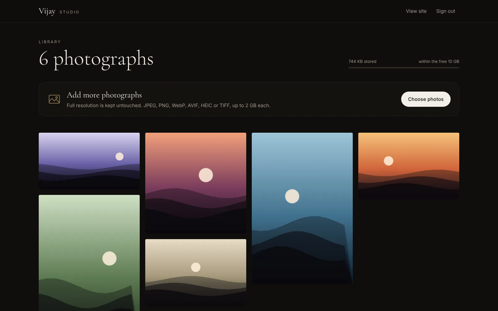

# Photography

A stylish, low-cost home for your photographs: a private studio to upload, view and
manage full-resolution work, and (in later steps) a public portfolio with in-browser
editing, sharing and framed previews that buyers can enquire about.

It's one web app that works on phones and desktops. On your phone, open the site and
choose **Add to Home Screen** to use the studio like an app.



## What's in step 1

- **Private studio** at `/studio`, behind your password.
- **Full-resolution uploads** straight from your browser to Cloudflare R2, in 16 MB parts,
  4 at a time, with automatic retries. If the connection drops or you close the tab,
  choose the same file again and it carries on where it stopped.
- **Originals are never changed.** Your browser also makes three web-sized copies
  (480, 1280 and 2560 px) for fast browsing, so the server never has to open huge files.
- **Camera details** (camera, lens, focal length, aperture, shutter, ISO, date) are read
  from the file. Location (GPS) is never read or stored.
- **Library** with a storage meter against R2's free 10 GB, a photo page with download
  of the original, rename and delete.

## How it's built (and why it's cheap)

| Piece | Service | Cost at small scale |
| --- | --- | --- |
| App | Next.js on Vercel | Free (Hobby), see note below |
| Photo files | Cloudflare R2 | Free up to 10 GB, then about $0.015/GB a month. No charge for views/downloads |
| Photo details | Postgres on Neon | Free tier |

Files go from your browser directly to R2 using short-lived signed links. They never
pass through the app server, which keeps it fast and inside free limits.

> **Note on Vercel's free plan:** Hobby is for non-commercial use. Your private studio is
> fine there. Before the public shop goes live, we'll decide between Vercel Pro
> ($20/month) or moving hosting to Cloudflare, which allows commercial use on its free plan.

## Setting it up

You'll need free accounts on Cloudflare, Neon and Vercel. Takes about 20 minutes.

### 1. Cloudflare R2 (photo storage)

1. In the Cloudflare dashboard, open **R2 Object Storage** and enable it (a card is
   required even on the free allowance).
2. **Create bucket** named `photography`. Leave it private (no public access).
3. Open the bucket → **Settings** → **CORS policy** → **Edit**, and paste (put your real
   site address in place of `https://your-site.vercel.app`):
   ```json
   [
     {
       "AllowedOrigins": ["https://your-site.vercel.app", "http://localhost:3000"],
       "AllowedMethods": ["GET", "PUT", "HEAD"],
       "AllowedHeaders": ["*"],
       "ExposeHeaders": ["ETag"],
       "MaxAgeSeconds": 3600
     }
   ]
   ```
   `ExposeHeaders: ETag` matters: without it, large uploads can't finish.
4. Back on the R2 overview, **Manage R2 API tokens** → **Create API token** with
   **Object Read & Write**, limited to the `photography` bucket. Note the
   **Access Key ID**, **Secret Access Key**, and your **Account ID**.

### 2. Neon (database)

1. Create a project at neon.tech (pick the region closest to you, e.g. Singapore or Mumbai).
2. Copy the **pooled** connection string. That's your `DATABASE_URL`.

### 3. Vercel (hosting)

1. **Add New → Project**, import this GitHub repository.
2. Under **Environment Variables**, add everything from [`.env.example`](.env.example):
   `DATABASE_URL`, `ADMIN_PASSWORD`, `SESSION_SECRET`, `R2_ACCOUNT_ID`,
   `R2_ACCESS_KEY_ID`, `R2_SECRET_ACCESS_KEY`, `R2_BUCKET`.
   Make `SESSION_SECRET` with:
   `node -e "console.log(require('crypto').randomBytes(32).toString('hex'))"`
3. Deploy. The database tables are created automatically on each deploy.
4. Add your Vercel address to the R2 CORS policy (step 1.3) if you hadn't yet.
5. Open `/studio`, sign in with your `ADMIN_PASSWORD`, and upload.

## Local development

```bash
npm install
cp .env.example .env.local   # fill in values
npm run db:migrate
npm run dev                  # http://localhost:3000
```

## Running the tests

```bash
npm test          # unit tests
npm run e2e       # browser tests (desktop + phone)
```

The browser tests need a Postgres database and an S3-compatible stand-in for R2
(for example [moto](https://github.com/getmoto/moto): `moto_server -p 4566`, then create a
`photography` bucket with the CORS rule above). Point `.env.local` at them with
`R2_ENDPOINT=http://localhost:4566`, then `npm run build && npm run e2e`.

## Where things live

- `src/lib/upload/` — upload engine (part planning, resume, retries) and browser-side image copies
- `src/lib/storage.ts` — R2 access and signed links
- `src/lib/db/` — database tables (`npm run db:generate` after changing `schema.ts`)
- `src/lib/auth/` and `src/proxy.ts` — studio login
- `src/app/studio/` — studio pages; `src/app/api/uploads/` — upload API
- `src/lib/site.ts` — site name and wording
